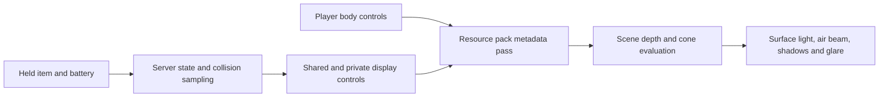

# FlashLight

**Directional flashlights for Minecraft horror maps, exploration, and multiplayer.**

FlashLight combines a visible beam with light on walls, floors, players, and mobs. Players carry a custom flashlight, manage its battery, and can experience random faults or scripted flicker. Other players see the light and approximate body shadows, and looking into a nearby beam produces adjustable glare.

The server controls the item and its optical data. A standard resource pack draws the light over Minecraft's existing scene, preserving textures and animations. The main renderer uses no particles or LIGHT blocks and requires no client mod or separate shaderpack.

**Current release: 1.8.1.** Paper 1.21.4–1.21.11, 26.1–26.1.2, 26.2, and 26.3. All documentation, configuration comments, and player messages are in English.

**1.8.1 grip correction:** the third-person lens faces forward, the switch sits on top, and the handle sits inside the vanilla fist in both hands. This corrects the reversed orientation left in 1.8.0. See the [technical before/after preview](docs/third-person-grip-preview.png). Install the matching 1.8.1 JAR and distribute its updated resource pack.

## Documentation and wiki

The [complete English wiki document](docs/FlashLight-Wiki-EN.txt) explains installation, every setting, commands, multiplayer behavior, item data, rendering, performance, integrations, troubleshooting, and development. It is a plain UTF-8 text file that can be downloaded or split into wiki pages.

The [verification report](docs/FlashLight-Verification-1.8.1.txt) records the checks performed on the release and their limits.

| Start here | What you will find |
| --- | --- |
| [Downloads](#downloads-and-versions) | Four server branches and their Java requirements |
| [Installation](#installation) | First setup and resource pack delivery |
| [Player guide](#using-the-flashlight) | Controls, batteries, and recipes |
| [Multiplayer](#shared-light-shadows-and-glare) | Sharing, shadows, camera tracking, and glare |
| [Commands](#commands) | Selectors, durations, and scripted effects |
| [Configuration](#configuration) | Main settings and safe reload behavior |
| [Pack providers](#resource-pack-providers) | Standalone hosting, Nexo, TRP, and StrobeLights |
| [Development](#building-and-verification) | Build commands and reproducible checks |

## Features

- Directional light with a soft cone edge, central hotspot, distance falloff, and an adjustable beam in the air.
- Surface lighting that follows real scene textures, including moving players and mobs.
- Shared multiplayer lighting and player body shadows, enabled by default.
- Distance and aim dependent glare when another flashlight points at your eyes.
- Frame based tracking for your own first-person beam, plus interpolated remote controls.
- Main-hand and off-hand support, with an adjusted third-person grip for other players and F5.
- Persistent batteries, replacement cells, crafting recipes, underwater behavior, and configurable sounds.
- Random electrical faults and timed commands for maps, command blocks, and scripted events.
- A bundled pack for each supported server branch and optional shared pack integrations.

## Downloads and versions

Download the [complete release ZIP](build/releases/FlashLight-1.8.1-complete.zip) for all four plugin JARs, their resource packs, the default configuration, and English documentation. Install **one** JAR on a server.

| Plugin file | Supported native server versions | Server Java |
| --- | --- | --- |
| [FlashLight-1.8.1-1.21.X.jar](build/libs/FlashLight-1.8.1-1.21.X.jar) | 1.21.4, .5, .6, .7, .8, .9, .10, .11 | 21 |
| [FlashLight-1.8.1-26.1.X.jar](build/libs/FlashLight-1.8.1-26.1.X.jar) | 26.1, 26.1.1, 26.1.2 | 25 |
| [FlashLight-1.8.1-26.2.X.jar](build/libs/FlashLight-1.8.1-26.2.X.jar) | 26.2 | 25 |
| [FlashLight-1.8.1-26.3.X.jar](build/libs/FlashLight-1.8.1-26.3.X.jar) | 26.3 | 25 |

The `X` identifies a release family. Future patches and snapshots require validation; the plugin checks its supported native versions during startup. This release starts at **1.21.4**, not earlier 1.21 releases. Protocol translation does not automatically select a different renderer for each client.

Each JAR embeds its matching pack. Separate ZIPs are available in [build/distributions](build/distributions). On startup, the plugin exports a pack resolved for the server's exact version to `plugins/FlashLight/FlashLight-ResourcePack.zip`.

## Installation

1. Stop Paper, select the JAR for its Minecraft branch, and place it in `plugins`. Remove the previous FlashLight JAR and restart.
2. Configure pack delivery. Supported Nexo/TRP installations can manage it; otherwise host the exported ZIP at a direct URL or enable FlashLight's HTTP server.
3. Accept the resource pack in the client. Run `/flashlight give`, hold the flashlight, and right-click.
4. Test against a wall, in both hands, in F5, and with a second player.

For upgrades, retain the plugin data directory and existing items, but distribute the new resource pack too. Version 1.8.1 requires its new control textures and shaders.

Standalone defaults export the pack without publishing it: the URL is empty, `send-on-join` is false, and the built-in HTTP host is disabled. Exporting a ZIP does not make it downloadable from the Internet.

The normal resource pack contains the shaders. An external shaderpack or rendering mod can replace the stages FlashLight uses. On OptiFine, start with **Shaders: OFF** and validate the exact client configuration.

## Using the flashlight

| Action | Result |
| --- | --- |
| Right-click while holding a flashlight | Toggle its switch |
| Sneak + right-click with a replacement battery in your inventory | Consume one cell and refill the flashlight |
| Hold it in either hand | Use the appropriate first-person lens position |
| Put it away, die, disconnect, or change world | Stop its active lighting session |

Each player has one active flashlight session. Charge is stored in the item. The default battery lasts 900 seconds of active use at 20 TPS; an unlit flashlight does not consume charge. There is no automatic HUD or battery action bar. Item lore shows charge.

The flashlight recipe is shaped:

```text
      GLASS_PANE
IRON_INGOT  REDSTONE  IRON_INGOT
      COPPER_INGOT
```

A replacement battery uses one copper ingot, one redstone, and one iron nugget in a shapeless recipe. A renamed vanilla shard is not a FlashLight battery.

## Shared light, shadows, and glare

These defaults enable the new multiplayer behavior:

```yaml
light:
  entities:
    enabled: true
  shared-light: true
  local-camera-tracking: true
  interpolation-ticks: 2
  shadows:
    enabled: true
    max-casters: 8
    update-interval-ticks: 2
  glare:
    enabled: true
    strength: 0.65
    max-distance: 12
```

Remote players see shared optical controls. The owner receives a private first-person control so their own beam can follow the camera each rendered frame; remote motion uses the configured display interpolation. This reduces visible steering delay when server updates arrive unevenly. It cannot restore a stalled server or remove network latency.

Player shadows use up to eight shared body approximations per world. A body can block the flashlight's added surface light even when that body is outside the observer's screen. The approximation follows the player's bounding box; it does not reproduce animated limbs, equipment, or mob silhouettes. It does not darken the world's natural light.

Glare increases with central aim and proximity, and decreases toward the edge of the cone. It checks visible depth and the shared body controls for obstruction. It affects the view without applying a blindness potion or changing player state. Glare settings are encoded into the pack: after changing them, reload and redistribute the updated ZIP.

The main renderer supports 32 active flashlight slots per world. The client only receives controls within normal entity tracking range.

## Commands

Use `/flashlight` or `/fl`. `flashlight.use` and `flashlight.pack` default to everyone; `flashlight.admin` defaults to operators.

```text
/flashlight give [targets]
/flashlight battery [targets] [amount]
/flashlight recharge [targets]
/flashlight on [targets] [duration]
/flashlight off [targets] [duration]
/flashlight flicker [targets] [duration] [strength_0_100] [pulse_interval]
/flashlight pack [export]
/flashlight reload
/flashlight help
```

Targets accept online player names and native selectors such as `@p`, `@a`, `@s`, and `@a[distance=..10]`. A player defaults to themselves; the console and command blocks must provide targets. Native execution preserves `/execute as ... at ...` context.

| Example | Result |
| --- | --- |
| `/flashlight give @a` | Give every online player a charged flashlight |
| `/flashlight off @a 5s` | Force it off for five seconds, then restore the previous switch state |
| `/flashlight on Explorer 40t` | Force Explorer's held flashlight on for 40 ticks |
| `/flashlight flicker @p 3s 85 4t` | Flicker for three seconds, losing 85% of power in the dim phase every four ticks |
| `/execute as @a at @s run flashlight flicker @s 2s 40 5t` | Apply a gentler fault in each player's execution context |

Durations accept seconds (`3`, `3s`, `0.5s`) or ticks (`40t`), from one tick to one hour. Pulse intervals have a two-tick minimum. Strength is the percentage of light lost: `100` is a complete blackout. Timed restoration applies only to the same flashlight while it remains held. Commands return the number of affected players for conditional command blocks.

## Configuration

See the [commented default config](src/main/resources/config.yml) and sections 10–18 of the [wiki document](docs/FlashLight-Wiki-EN.txt) for every default, range, and interaction.

| Setting | Default | Purpose |
| --- | --- | --- |
| `light.range` | `20.0` | Maximum optical range, 4–32 blocks |
| `light.cone-angle-degrees` | `28.0` | Total opening, 4–65 degrees |
| `light.max-brightness` | `12` | Relative intensity, 4–15 |
| `light.beam-visibility` | `1.0` | Air beam strength, 0–3; direct lighting is independent |
| `light.follow-player-movement` | `true` | Direct server tracking |
| `light.interpolation-ticks` | `2` | Remote display interpolation, 1–5 ticks |
| `light.update-interval-ticks` | `2` | Collision refresh, not camera refresh |
| `battery.duration-seconds` | `900` | Active battery life at 20 TPS |
| `flicker.enabled` | `true` | Random faults; scripted flicker remains available when false |
| `light.waterproof` | `false` | Whether a submerged flashlight emits light |

Run `/flashlight reload` after editing. It stops active lights and rebuilds the services, recipes, and pack export. Missing configuration keys are added while existing values, comments, unknown keys, `false`, zero, and empty lists are preserved. The first migration creates `config.yml.before-update.bak`. Invalid YAML is rejected without overwriting it.

Most optical settings travel in entity metadata. Glare changes require the updated pack on clients. `light.entities.enabled: false` selects the older block-surface fallback; that mode does not provide the main renderer's entity lighting, body shadows, or face glare.

## Resource pack providers

- **Standalone:** use a direct ZIP URL and SHA-1, or enable the optional HTTP host with a public URL clients can reach. `/flashlight pack` requests the active pack; `/flashlight pack export` shows its local path.
- **Nexo:** `AUTO` uses a MultiPack template on supported Nexo 1.27+ installations and `external_packs` on older versions. Nexo hosts and sends the shared pack. Existing administrator choices in `multipack.yml` are preserved. See [Nexo's MultiPack documentation](https://docs.nexomc.com/configuration/resourcepack/multipack-feature).
- **TRP Server Edition:** its overlay API combines the flashlight branch with the host renderer, retaining the host's rendering path and pack provider.
- **StrobeLights:** matching native resources can be composed into the flashlight pack while retaining Strobe's marker renderer. Legacy integrations have regression fixtures; every external plugin still needs a renderer compatible with the server version in use.

FlashLight's version support does not upgrade another plugin's old shader or certify every external plugin release. See section 18 of the wiki for provider priority, format handling, and integration limits.

## How the light works



Technical displays carry compact optical data into Minecraft's native outline pass. The five-pass postprocessing graph decodes it, reconstructs visible surfaces from depth, evaluates the beam and obstruction, and blends the result with the scene. It preserves scene depth and ordinary entity outlines.

This is a visual lighting effect. It cannot recover texture detail from a completely black pixel. Screen depth cannot describe every off-screen wall; server collision sampling and bounded player controls complement it. Transparency and rendering mods retain the limitations of the relevant Minecraft renderer. The wiki explains these constraints before discussing implementation details.

## Model sources

The supplied Blockbench geometry is retained, with separate on, off, and low-power appearances. The third-person rotation and translation point the lens forward, roll the switch to the top, and bring the handle inside the hand. Both left and right poses are covered. First-person optical constants are generated from the same lens geometry and display transforms as the pack.

- Original model: [models/source/Flashlight.bbmodel](models/source/Flashlight.bbmodel)
- Editable model: [models/Flashlight-adaptada.bbmodel](models/Flashlight-adaptada.bbmodel)
- Conversion details: [models/conversion-report.json](models/conversion-report.json)
- Technical model preview: [docs/model-preview.png](docs/model-preview.png)

The player's arms keep Minecraft's native item rendering behavior.

## Building and verification

Use a Java 21 installation for the Gradle build. Native 26.x server probes additionally require Java 25.

```powershell
.\gradlew.bat build smokeProbe
python tools/validate_pack.py
python tools/run_compat_smoke.py
python tools/package_release.py
```

The native probe requires an existing accepted `eula.txt`; its `--eula` argument accepts that path. All probe servers and worlds stay under `build/compat-smoke`. The probe is separate from the distributed plugin.

Automated checks cover plugin behavior, item persistence, configuration migration, provider integration, held geometry, multiplayer control visibility, actual OpenGL shader output, version-specific shader compilation, and 26.3 SPIR-V compilation. Native Paper probes check startup and display behavior across the published server versions. The [verification report](docs/FlashLight-Verification-1.8.1.txt) distinguishes these checks from live multiplayer client testing and production server profiling.

To regenerate assets, see section 31 of the wiki. Generated shader adaptations are committed to the project, so an ordinary build does not download Minecraft clients.

## License

Copyright © 2026 MrDino. Original FlashLight code, assets, and documentation are licensed under [CC BY-NC-ND 4.0](LICENSE), unless otherwise indicated. The complete official English license text is included in that file and is also available from [Creative Commons](https://creativecommons.org/licenses/by-nc-nd/4.0/). Third-party material retains its respective licenses and notices.
